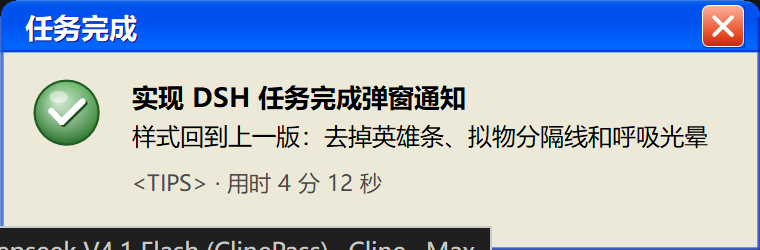

# dsh-turn-notify

DSH 插件：每一轮任务结束时，在**桌面右下角**弹出一张置顶卡片，**必须手动关闭**（点关闭按钮 / 右键 / Esc），不会自动消失。附带一个 DSH 设置页，可开关、调参并预览效果。



## 启动方式（先澄清一件事）

这里**没有独立服务、没有托盘进程、也没有"自启"概念**：

- 插件是**宿主插件**，运行在 DSH 的宿主进程里。宿主进程由 DSH 桌面应用（Electron）在启动时拉起，应用退出即结束。
- DSH 应用本身自带**系统托盘图标**（隐藏窗口后的回到入口 + 显式退出），这是应用的能力，不是本插件提供的。
- 所以「启用/关闭通知」是设置页里的开关；「开机自启」只可能指**开机自启 DSH 应用**，设置页里那一条就是在做这件事（在「启动」文件夹创建/删除快捷方式），与本插件是否加载无关。

## 安装

要求：**Windows** + DSH 桌面版。宿主半边运行在 DSH 宿主进程里，靠 PowerShell 画原生窗口，所以没有跨平台回退。

1. 把本仓库放进 profile 的插件目录：`<DSH_HOME>/profiles/<profile>/plugins/dsh-turn-notify/`（`<DSH_HOME>` 默认是 `~/.dsh`）。
2. 在 `<DSH_HOME>/profiles/<profile>/cordis.patch.yml` 末尾追加装载条目（代码块见下方「安装位置」）。
3. 重启一次 DSH：设置页那一节只会在重启后的客户端模块扫描里出现，原因见「客户端半边的坑」。

装好后在 **设置 → 任务通知** 里开关与调参，用「测试弹窗」立即预览。

## 安装位置

| 用途 | 路径 |
| --- | --- |
| 插件源码（唯一副本） | `~/.dsh/profiles/desktop/plugins/dsh-turn-notify/` |
| 工作区别名（目录联接） | `<工作区>/dsh-turn-notify` |
| 装载入口 | `~/.dsh/profiles/desktop/cordis.patch.yml` |
| 设置文件（设置页写入） | `~/.dsh/turn-notify.config.json` |
| 诊断日志 | `~/.dsh/turn-notify.log.jsonl` |

装载入口是 profile 补丁层里的一条 insert 条目（相对路径按 **profile 根目录**解析）：

```yaml
- insert:
    - id: turn-notify
      name: './plugins/dsh-turn-notify/lib/index.js'
      config:
        logFile: 'C:\Users\<你>\.dsh\turn-notify.log.jsonl'
```

### 热重载行为（实测）

- 补丁文件的**真实配置变化**会在约 2 秒内触发重载，无需重启应用。
- 只改注释不算变化（YAML 解析结果相同），不会触发。
- 改 `lib/index.js` / `lib/popup.ps1` 后，下一次配置变化触发重组时会检测到模块文件已变并重新导入；只改代码不改配置不会自动生效。
- 补丁文件会被 DSH 自己重写并丢弃独立注释行，说明文字请写在本文件里。
- **改 entry 的 `name` 会让重组中止**（HMR 找不到旧模块来卸载），所以别指望靠改路径热切换。
- 重载若正好落在某个回合中间，新实例没看到这个回合的 `turn/start`。这时会从会话日志里
  补回真实的开始时间与提问（`session.snapshotEvents()`）；补不回来才退化成「用时 未知」，
  **不会**因为把时长误算成 0 而丢掉通知。

### 客户端半边的坑（重要）

宿主进程的客户端模块扫描把「每个装载入口名 → 包元数据」**永久缓存**（`dsh-client-modules` 的
`pkgMeta` 只有写入、没有失效）。后果：如果某个入口第一次被扫描时它的 `package.json` 里还没有
`dsh.client`，之后即使补上声明，**这个宿主进程也永远不会重新识别它**。

本插件就踩过这个坑（先加载、后补 `dsh.client`），所以设置页需要**重启一次 DSH** 才会出现；
重启后扫描从零开始，声明齐全，之后就一直正常。

## 设置页

DSH 设置里新增一节「任务通知」（`settings.section` 槽位，`lib/client.js`）：

| 项 | 说明 |
| --- | --- |
| 启用任务通知 | 总开关 |
| 子代理也通知 | 默认关；一个回合可能派发多个子代理 |
| 提示音 | 卡片出现时播放系统提示音 |
| 应用在前台时不打扰 | 前台窗口是本应用时跳过 |
| 最短时长 | 短于该毫秒数的轮次不弹（默认 2000） |
| 测试弹窗 | 立即在右下角弹一张示例卡片 |
| 开机自启 DSH | 在「启动」文件夹创建/删除 `DeepSeek Harness.lnk` |

配置优先级：**默认值 < 补丁条目 config < 设置页写入的文件**，设置页每次改动立即生效（下一轮就用新值）。

## 通知文案

卡片自上而下：

- **窗口标题栏**：结果状态（任务完成 / 任务出错 / 任务已中断 / 达到长度上限 / 任务被阻止），
  配对应状态图标。
- **对话总结标题**（粗体）：当前对话的标题，作为正文的首行。
- **正文**：你这一轮的提问（截断到 100 字，最多四行，超出省略）。
- **说明行**：`<目录名> · 用时 <时长>`，出错时追加错误信息。
  时长用中文可读写法：`12.3 秒` / `30 分 25 秒` / `1 小时 5 分`（不再用 `30m 25s` 这种缩写）。
  本实例没看到回合开始、日志里也补不回来时写 `用时 未知`。

### 总结标题从哪来

宿主会为每个对话生成一次标题（`session/title`，`data.title`）：先写一条由首轮提问拼出的
fallback，随后由 LLM（`session-title-first-prompt-llm`）覆盖成真正的总结，例如
`实现DSH任务完成弹窗通知`。它**每对话只发一次，而且发生在很早的时候**，所以插件两条路都走：

1. 实时监听 `session/title`，按 session id 记住；
2. 该 session 没有实时收到时（插件是在对话开始之后才加载的，这是常态），
   从 `session.snapshotEvents()` 里往回找最新一条 `session/title`。

两条路都没有时就不画标题行，卡片照样弹。日志里 `popup shown (…, heading=…)` 能看到用了哪个标题。

只有 `source.kind === 'user'` 的消息会被当成提问：一轮里还会追加 `agent-instructions`、
`runtime-context`、`skill-catalog`、`time-context` 等注入消息，它们不会出现在卡片上。

## 外观：Windows XP Luna

按 `XP.css`（`themes/XP/_window.scss`）的配方还原，而不是"差不多像"：

- **三像素蓝色窗口边框**，由六条 inset 一像素边构成：
  `#0831d9/#00138c`、`#166aee/#001ea0`、`#0855dd/#003bda`（上左/下右）。
- 顶部圆角 8px、底部直角；只有客户区被蓝色边内缩 3px。
- **八段式 Luna 标题栏渐变**：
  `#0997ff 0% → #0053ee 8% → #0050ee 40% → #0066ff 88% → #0066ff 93% → #005bff 95% → #003dd7 96% → #003dd7 100%`。
- 标题字体 **Microsoft YaHei UI 粗体 14px**，白色，带 `#0f1089` 一像素投影。
  **标题栏没有图标**——真实 XP 消息框的标题栏只有左对齐标题和关闭按钮。
- 标题按钮 21×21，**在 26px 标题栏里垂直居中**：1px 白边、3px 圆角、`1px 1px 0 #003bda` 投影；
  关闭按钮用 `#ffb19c → #e44821 72% → #bc2515` 红橙渐变，白色叉号按按钮像素中心对齐。
- **唯一的关闭控件就是标题栏那个 X**（另有右键 / Esc），没有额外的按钮行。
- 客户区是 **XP 消息框内部**：32px 状态图标**与正文首行顶对齐**（不居中），
  右侧正文，下方一行弱化说明。

### 试过又撤掉的一版（别再加回来）

曾经照"网吧到账提醒"的观感加过：铺满宽度的**状态色英雄条**（16px 粗体白字写
`任务完成 · 用时 …`）、**拟物分隔线**、状态图标**呼吸光晕**，并把对话标题挪到标题栏。
用户评价是"不如之前的样子，有点狗尾续貂"，于是全部撤回。

结论：这张卡**保持安静**——结果状态留在标题栏、对话标题做正文的粗体首行、
其余信息一行小字。**不要再往这个方向加装饰**。

状态图标按 XP 系统图标的画法重做，而不是纯色圆片：

- 圆形（完成/出错/已分叉）：竖向底色渐变 + **左上角径向高光**（`PathGradientBrush`，
  中心偏 38%/31%）+ 更暗的一圈描边 + 顶部一小块镜面白点，颜色保持饱和而不是整体压暗。
- 三角（中断/警告）：圆角三角 + `#fffde8 → #ffe25c → #e8a400` 三段渐变 + 深色描边 + 黑色叹号。
- 白色字形带 0.9 单位的下右偏移暗影，这是 XP 图标自带的立体感来源。

字体与尺寸：标题 14px 粗体、正文的对话标题行 13px 粗体、正文 Microsoft YaHei UI 12px、
说明行 11px。字体族按
`Microsoft YaHei UI → Microsoft YaHei → SimHei → Tahoma` 依次探测；
不显式指定 CJK 字族时 GDI+ 会给中文回退到宋体，那正是之前"看着像宋体"的原因。

内部内容**从左上角自上而下排列**（图标顶对齐、正文在其右、说明行在下方），
不做水平或垂直居中。比例取自 XP.css 的对话框配方（`gap:14px; padding:14px 14px 10px`、
图标 32px、`--title-h:22px`）：14px 内边距、14px 图标与文字间距。

**卡片高度贴合内容**，像真实消息框一样；只有 96px 的客户区下限，避免单行通知塌成一条。
卡片高度按 `TextRenderer.MeasureText` 量出的行数自适应，正文最多四行；
所有像素指标按屏幕 DPI 缩放，字体用点（pt）由 GDI+ 自行按 DPI 解析。

### 两个踩过的坑

- **鼠标指针不换成手型**。系统 `IDC_HAND` 资源在这台机器上只有 32px（实测弹窗进程内
  `hand=32x64`、`arrow=64x128`），在 200% 缩放下手型只有一半大；换成"整块渐变提亮"作为
  hover 提示（实测按钮区域均值 `G 126→182`）。
- **必须双缓冲**。整卡是自绘的，hover 重绘若不缓冲，边框和文字会撕裂一帧（就是鼠标划过
  关闭按钮时的闪烁）。同时 `Invalidate` 只传按钮矩形 + 3px 外扩，其余部分不重绘。
  另外 `DshNotify.Card` 子类**必须全限定类型名并引用 `System.ComponentModel.Primitives`**：
  少了引用时 `Add-Type` 会失败，而 `catch` 会静默回退成普通 `Form`——双缓冲和投影一起消失。

## 测试与预览

```powershell
# 行为自检（14 项，会真的弹窗，并确认它 2 秒后仍未被自己关闭）
node "$env:USERPROFILE\.dsh\profiles\desktop\plugins\dsh-turn-notify\test\smoke.mjs"

# 直接预览渲染效果，不经过 DSH
$payload = @{ kind = 'completed'; title = '任务完成'; body = "示例任务`n第二行"; meta = 'TIPS · 用时 12.3s'; accent = '#2E7D32'; sound = $false } |
  ConvertTo-Json -Compress
$b64 = [Convert]::ToBase64String([Text.Encoding]::UTF8.GetBytes($payload))
pwsh -NoProfile -STA -ExecutionPolicy Bypass -File "$env:USERPROFILE\.dsh\profiles\desktop\plugins\dsh-turn-notify\lib\popup.ps1" -Payload $b64
```

## 卸载

删除 `cordis.patch.yml` 里对应的 insert 条目即可，HMR 会即时卸载插件；随后可删除 `plugins/dsh-turn-notify/`、工作区别名与 `~/.dsh/turn-notify.config.json`。

## 实现备注

- `lib/popup.ps1` 保持纯 ASCII：Windows PowerShell 5.1 读取无 BOM 的 `.ps1` 时按系统 ANSI 代码页解码，
  所以所有中文都走 `-Payload`（base64 的 UTF-8 JSON）显式解码。
- 整个卡片由 `Paint` 一次画完（边框、标题栏、图标、标题文字、按钮、正文），没有子控件，
  因此 z 序、圆角裁剪和 DPI 缩放都可控；关闭按钮用命中测试处理 hover 与点击。
- 子进程不使用 `detached`：本环境里 detached 子进程起不来；渲染器只需活过自己那个窗口。
- 显示后显式 `SetWindowPos(HWND_TOPMOST)`：PowerShell 7 下 `Form.TopMost` 不会落到窗口句柄上，
  只靠属性会让卡片被应用窗口盖住。

## 许可

[MIT](LICENSE)。
